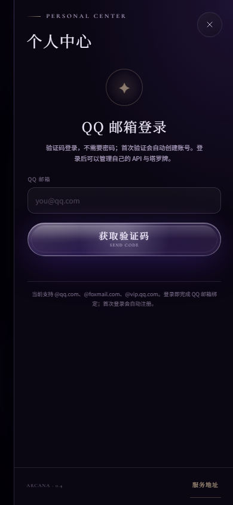
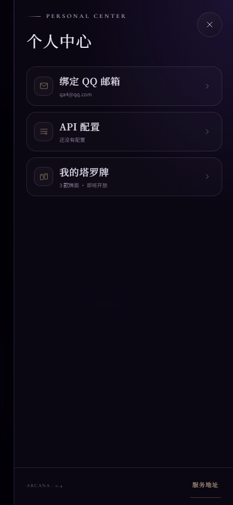
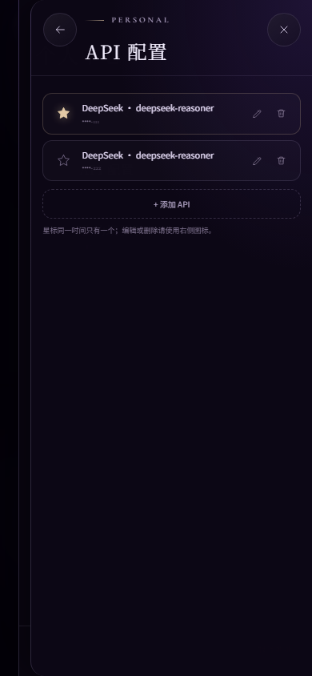
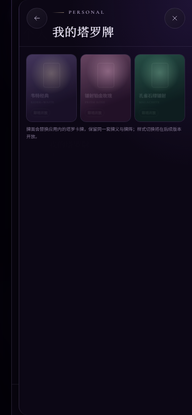

# ARCANA · 塔罗占卜 App

一个可以安装到 Android 手机的独立塔罗 App，配套一个部署在云端的 Node.js 后端。

手机端负责界面、抽牌、选牌和个人中心。云端负责 QQ 邮箱验证码登录、API Key 加密保存、服务商调用与解读生成。登录和调用 API 都不需要电脑参与，但后端需要先部署一次。

当前版本：0.4.0  
包名：`com.arcana.tarot`

---

## 预览

| 首页 | QQ 邮箱登录 |
| --- | --- |
|  |  |

| 个人中心 | 绑定 QQ 邮箱 |
| --- | --- |
|  |  |

| API 配置 | 我的塔罗牌 |
| --- | --- |
|  |  |

| 选择牌阵 | 解读结果 |
| --- | --- |
|  |  |

---

## 功能

### 账号

- QQ 邮箱验证码登录，支持 `@qq.com`、`@foxmail.com`、`@vip.qq.com`
- 首次验证自动注册，不需要密码
- Session 使用随机 Bearer Token，服务端只保存 Token 的 SHA-256
- 退出登录会撤销服务端 Session

### 个人中心

首页右上角头像打开右侧抽屉。

- 绑定 QQ 邮箱
- API 配置
- 我的塔罗牌

三个入口都从右侧滑入独立面板，左上角返回，右上角关闭。主页只保留入口卡，不会因配置过多被拉长。

### API 配置

- 服务商与模型下拉
- 星标表示当前使用的 API
- 使用中的星为黄色实心，其他配置为灰色空心
- 每条配置右侧提供编辑和删除图标
- 编辑支持修改服务商、模型和 Key
- 每个账号最多保存 20 个配置，星标唯一

支持的服务商：

DeepSeek、OpenAI、Anthropic Claude、Google Gemini、阿里云百炼 Qwen、Moonshot Kimi、智谱 GLM、火山方舟豆包、腾讯混元、百度文心、xAI Grok、Mistral、OpenRouter。

完整模型列表和官方文档见 [`docs/PROVIDERS.md`](docs/PROVIDERS.md)。

### 真实调用

- 添加或保存编辑时，服务端真实请求服务商的最小测试接口
- 只有测试成功才写入数据库
- 切换星标时也会再次校验
- 解读只读取星标 Key
- 删除星标 Key 后，自动把最近一条配置提升为星标
- 支持 OpenAI 兼容、Claude、Gemini 三种协议

### 我的塔罗牌

当前提供三种牌面占位：

- 韦特经典
- 镭射铂金玫瑰
- 孔雀石绿镭射

后续版本会替换应用内的塔罗卡牌，保留同一套牌义与牌阵。

---

## 免费部署

推荐的零成本组合：

- Render Free：运行后端
- Supabase Free Postgres：保存账号、Session、API Key
- Mailjet Free：发送 QQ 邮箱验证码

不需要买域名，也不需要买服务器。Render 会提供 `https://xxx.onrender.com` 地址。

Render 免费实例不能挂持久磁盘，并且封锁 SMTP 端口，所以不能直接使用 SQLite 和 QQ SMTP。当前代码已经支持 Postgres 和 Mailjet 的 HTTPS API。

完整步骤见 [`docs/DEPLOY.md`](docs/DEPLOY.md)。

### 免费方案限制

- Render 免费实例闲置后休眠，首次请求可能等待 30–60 秒
- Supabase 免费项目连续 7 天无活动会暂停
- Mailjet 免费额度约 200 封/天，6000 封/月
- 适合几个朋友使用，不适合大量公开用户

---

## 本地运行

环境要求：

- Node.js 24+
- npm

安装依赖：

```bash
npm install
```

复制环境变量：

```bash
copy .env.example .env
```

生成 `APP_SECRET`：

```bash
node -e "console.log(require('crypto').randomBytes(32).toString('hex'))"
```

本地最小配置：

```dotenv
APP_SECRET=上一步生成的64位字符
DB_PATH=./data/arcana.db
MAIL_MODE=console
```

启动：

```bash
npm start
```

开发时 `MAIL_MODE=console` 会把验证码打印到服务端日志。

默认地址：

```text
http://localhost:4173
```

---

## 手机连接

安装 APK 后：

- 头像 → 服务地址 → 填后端 HTTPS URL
- 使用 QQ 邮箱获取验证码
- 在 API 配置中添加自己的 API Key
- 点星标设为当前使用

如果希望朋友安装后不用填地址，构建 APK 时写入：

```powershell
$env:ARCANA_API_BASE_URL="https://你的服务.onrender.com"
npm run android:debug
```

---

## APK

当前测试包：

```text
dist/arcana-0.4.0-debug.apk
```

- 包名：`com.arcana.tarot`
- 版本：0.4.0（versionCode 4）
- 最低 Android：6.0
- 目标 SDK：35
- debug 签名，可直接侧载

安装：

```bash
adb install -r dist/arcana-0.4.0-debug.apk
```

SHA256：

```text
3663BE5C5F614AEE3056E3B64A89219A20FBD5A81749B52A5BAF20B83D4BA304
```

如果安装过更早的测试包并提示签名冲突，先卸载旧版。

---

## 给朋友使用

只需要部署一次后端。

- 朋友安装同一个 APK
- 用自己的 QQ 邮箱登录
- 各自添加自己的 API Key
- 账号、Session、API Key 按 `user_id` 隔离
- 邮件验证码由你的 Mailjet 账号发出

朋友不需要自己部署后端。只有希望拥有完全独立数据库时，才需要各自部署。

---

## 项目结构

```text
arcana-tarot/
├── app/                   前端源码
├── server/                Node.js + Express 后端
│   ├── db.js              SQLite + Postgres 适配层
│   ├── mail.js            console / SMTP / Brevo / Mailjet
│   ├── routes/            auth、keys、readings
│   ├── services/          auth、apiKeys、providers、ai
│   └── middleware/
├── shared/tarot.js        78 张牌、28 个牌阵
├── android/               Capacitor Android 工程
├── scripts/               build-web、build-android
├── docs/
│   ├── DEPLOY.md
│   ├── ANDROID.md
│   ├── PROVIDERS.md
│   └── previews/
├── test/                  SQLite、Postgres、邮件测试
├── dist/                  APK
├── Dockerfile
├── render.yaml
└── package.json
```

---

## 测试

```bash
npm test
```

覆盖内容：

- QQ 邮箱验证码注册、登录、Session、退出
- 未登录不能解读
- API 添加、编辑、星标、删除
- Key 加密存储
- 星标唯一
- 解读使用星标服务商
- OpenAI 兼容、Claude、Gemini 三种协议
- SQLite 与 Postgres 适配层
- Brevo、SMTP2GO、SendGrid 与 Mailjet HTTPS 邮件请求
- CORS

自动化测试使用本地假上游、内存 Postgres（pg-mem）和模拟邮件响应。真实 Supabase、Mailjet 发信仍需要你自己的账号。

---

## 设计

- 近黑紫底、雾紫、月白、旧金
- 本地字体、玻璃拟态、粒子、星轨
- 右侧个人中心抽屉
- 横向滑入的子面板
- 果冻胶囊按钮
- 安全区、`dvh`、Pointer Events、44px 触控区域
- 已测试 390×844、360×640、320×568

---

## 文档

- [`docs/DEPLOY.md`](docs/DEPLOY.md)：免费部署完整步骤
- [`docs/ANDROID.md`](docs/ANDROID.md)：APK 构建、安装、签名
- [`docs/PROVIDERS.md`](docs/PROVIDERS.md)：服务商与模型
- [`PRIVACY.md`](PRIVACY.md)：隐私说明
