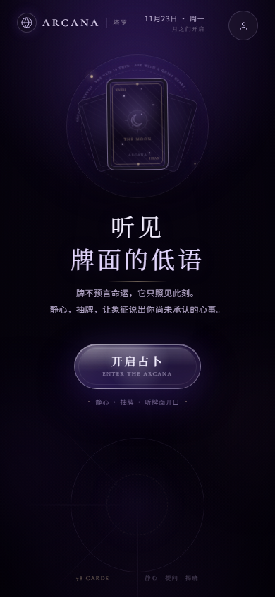
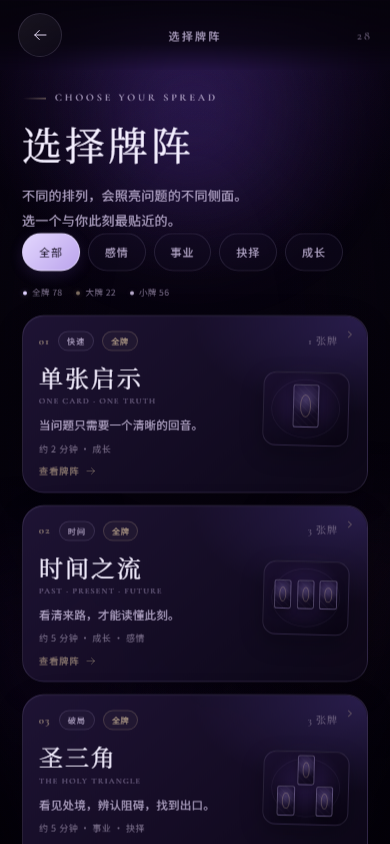
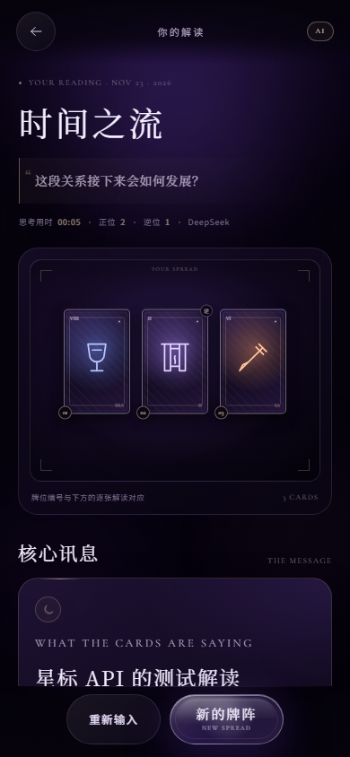

# ARCANA · 塔罗占卜 App

你的塔罗助手

一个可以安装到 Android 手机的独立塔罗 App，配套一个部署在云端的 Node.js 后端。

手机端负责界面、抽牌、选牌和个人中心；云端负责 QQ 邮箱验证码登录、API Key 加密保存、服务商调用与解读生成。**登录和调用 API 都不需要电脑参与**，但后端需要先部署一次（Render / Railway / VPS / Docker 均可）。

> 当前版本：`0.4.0`，包名 `com.arcana.tarot`。
> Android 安装包构建在 [`dist/arcana-0.4.0-debug.apk`](dist/arcana-0.4.0-debug.apk)。

---

## 预览

| 首页 · 右上角个人中心 | QQ 邮箱登录 |
| --- | --- |
|  |  |

| 个人中心 · 入口 | 绑定 QQ 邮箱 |
| --- | --- |
|  |  |

| API 配置 · 星标 | 我的塔罗牌 |
| --- | --- |
|  |  |

| 选择牌阵 | 解读结果 · 使用星标 API |
| --- | --- |
|  |  |

---

## 功能

### 账号

- QQ 邮箱验证码登录，支持 `@qq.com`、`@foxmail.com`、`@vip.qq.com`。
- 首次验证自动注册，不需要密码。
- 登录后显示当前绑定的 QQ 邮箱。
- Session 使用随机 Bearer Token，服务端只保存 Token 的 SHA-256。
- 退出登录会撤销服务端 Session。

### 个人中心

首页右上角头像打开右侧抽屉，可收起 / 展开：

- **绑定 QQ 邮箱**：横向面板显示当前绑定邮箱，登录即绑定。
- **API 配置**：添加、编辑、删除、星标 API；星标为黄色实心星，其他配置为空心描边星；编辑和删除使用图标按钮。
- **我的塔罗牌**：韦特经典、镭射铂金玫瑰、孔雀石绿镭射三种牌面占位，样式切换后续开放。
- **左右面板**：个人中心主页只保留两个入口卡；点击 API 配置或我的塔罗牌时，从右侧滑入一个独立面板，左上角返回、右上角关闭，类似打开新弹窗，不会占用主页纵向空间。

### API 配置

- 服务商与模型下拉：DeepSeek、OpenAI、Anthropic Claude、Google Gemini、阿里云百炼 Qwen、Moonshot Kimi、智谱 GLM、火山方舟豆包、腾讯混元、百度文心、xAI Grok、Mistral、OpenRouter。
- 完整模型列表和官方文档见 [docs/PROVIDERS.md](docs/PROVIDERS.md)。
- 模型列表变化很快，界面支持「自定义模型 ID」。
- Key 使用 AES-256-GCM 加密后存入 SQLite，接口只返回尾号，绝不返回完整 Key。
- 每个账号最多保存 20 个配置，星标唯一。

### 真实调用校验

这不是只在前端「假装保存」：

- 添加或保存编辑时，服务端会用该 Key 真实请求服务商的最小测试接口；只有成功才写入数据库。
- 点星标时会再真实调用一次；成功后才切换唯一星标。
- 发解读时读取星标 Key，按对应服务商协议请求；失败会把状态标成「调用失败」，不会静默换 Key。
- 删除星标 Key 后，会自动把最近的一条配置提升为星标。
- 全部逻辑都有集成测试覆盖，包括 OpenAI 兼容、Claude、Gemini 三种协议适配。

---

## 给朋友使用

不需要每个朋友都部署后端。

- **你部署一次**，得到一个 HTTPS 地址；所有朋友共用这个后端。
- 朋友下载同一个 APK，用自己的 QQ 邮箱登录即可；首次验证会自动注册。
- 账号、Session、API Key 都按 `user_id` 隔离，朋友之间看不到彼此的 Key。
- 每个朋友填写自己的 API Key，模型调用费用走各自的 Key，不消耗你的额度。
- 邮件验证码从你配置的 QQ SMTP 发出；注意 QQ 邮箱的日发送限制，朋友多时建议换邮件服务。
- 想让朋友完全不用设置，可以在构建 APK 时把 `ARCANA_API_BASE_URL` 写成你的后端地址；他们仍然可以在「服务地址」里覆盖。
- 只有朋友希望拥有完全独立的后端和数据库时，才需要各自部署。

所以「第一次使用」指的是**每个用户第一次打开 App**；后端只需要你部署一次。

## 后端部署（一次性）

### 1. 环境

- Node.js 24+
- 一个持久化目录（SQLite）
- 一个 QQ 邮箱的 SMTP 授权码

### 2. 本地启动

```bash
npm install
copy .env.example .env
```

生成 `APP_SECRET`：

```bash
node -e "console.log(require('crypto').randomBytes(32).toString('hex'))"
```

`.env` 至少填写：

```dotenv
APP_SECRET=上一步生成的64位字符
DB_PATH=./data/arcana.db
MAIL_MODE=console
```

开发时 `MAIL_MODE=console` 会把验证码打印到服务端日志。

```bash
npm start
```

### 3. QQ 邮箱 SMTP

1. 登录 QQ 邮箱网页版；
2. 设置 → 账户 → 开启「POP3/SMTP 服务」；
3. 生成「授权码」；
4. 填入：

```dotenv
MAIL_MODE=smtp
SMTP_HOST=smtp.qq.com
SMTP_PORT=465
SMTP_SECURE=true
SMTP_USER=你的QQ邮箱@qq.com
SMTP_PASS=QQ邮箱授权码
```

此时手机才会真正收到验证码。**不要把授权码放进 APK。**

### 4. 部署到云端

可以用 Docker：

```bash
docker build -t arcana .
docker run -d --name arcana \
  -p 4173:4173 \
  -v arcana-data:/data \
  --env-file .env \
  arcana
```

或者用仓库里的 [render.yaml](render.yaml) 在 Render 创建 Docker 服务；需要 1 GB 持久磁盘和 SMTP 环境变量。

完整的分步说明见 [docs/DEPLOY.md](docs/DEPLOY.md)。

部署完成后，得到一个 HTTPS 地址，例如：

```text
https://arcana-api.onrender.com
```

手机 App 的「服务地址」填写它，之后使用完全不需要电脑。

---

## APK

### 安装

```text
dist/arcana-0.4.0-debug.apk
```

- 包名：`com.arcana.tarot`
- 版本：0.4.0（versionCode 4）
- 最低 Android 6.0
- 目标 SDK 35
- debug 签名，可直接侧载

安装方式：

1. 把 APK 发到手机，用文件管理器点击安装；如果安装过早期测试包并提示签名冲突，先卸载旧版再装；
2. 或开启 USB 调试后：

```bash
adb install -r dist/arcana-0.4.0-debug.apk
```

第一次打开：

1. 点首页右上角头像；
2. 如果后端地址未预置，点抽屉底部「服务地址」填写 HTTPS 地址；
3. 用 QQ 邮箱获取验证码并登录；
4. 在「API 配置」里添加 Key，点「添加 API」保存；
5. 星标成功后开始解读。

### 重新构建

需要 JDK 21、Android SDK 35、Node 24+：

```bash
npm run android:debug
```

产物会复制到 `dist/arcana-0.4.0-debug.apk`。也可以：

```bash
npm run android:open
```

用 Android Studio 打开工程。详细签名、局域网调试、release 说明见 [docs/ANDROID.md](docs/ANDROID.md)。

构建时预置后端地址：

```powershell
$env:ARCANA_API_BASE_URL="https://arcana-api.onrender.com"
npm run android:debug
```

App 内「服务地址」仍可覆盖。

---

## 文件结构

```text
arcana-tarot/
├── app/                         # WebView / 浏览器前端源码
│   ├── index.html
│   ├── css/
│   ├── js/                      # app.js、api.js、runtime-config.js
│   └── assets/
├── server/                      # Node.js + Express 后端
│   ├── app.js                   # 路由、CORS、错误处理、静态资源
│   ├── db.js                    # SQLite schema
│   ├── auth.js / mail.js
│   ├── routes/auth.js           # 邮箱验证码、Session
│   ├── routes/keys.js           # 添加、编辑、星标、删除
│   ├── routes/readings.js       # 使用星标 Key 解读
│   ├── services/
│   │   ├── auth.js
│   │   ├── apiKeys.js
│   │   ├── providers.js         # 13 个服务商、模型、协议适配
│   │   ├── ai.js
│   │   ├── prompt.js
│   │   └── fallback.js
│   └── middleware/
├── shared/tarot.js              # 78 张牌、28 个牌阵（前后端共用）
├── android/                     # Capacitor Android 工程
├── assets/icon.png              # 图标源
├── scripts/                     # build-web、build-android
├── docs/
│   ├── previews/
│   ├── ANDROID.md
│   ├── PROVIDERS.md
│   └── DEPLOY.md
├── test/api.test.js             # 账号、Key、星标、真实调用、CORS 集成测试
├── dist/
├── Dockerfile
├── render.yaml
├── capacitor.config.json
└── package.json
```

---

## 验证

```bash
npm test
```

当前覆盖：

- QQ 邮箱验证码注册 / 登录 / Session / 退出；
- 未登录不能解读；
- 添加 API 前真实测试，失败不落库；
- Key 加密存储，数据库里没有明文；
- 星标唯一，星标前再次真实测试；
- 删除星标后自动提升下一条；
- 解读使用星标服务商；
- OpenAI 兼容、Claude、Gemini 三种协议；
- CORS 允许 Capacitor 的 `https://localhost` 与 `Authorization` 头。

> 自动化测试使用本地假上游和内存邮件器验证协议、加密与数据库逻辑；此外已用真实 DeepSeek Key 在内存数据库中走通了「添加 → 星标 → 星标解读 → 删除」全流程，真实服务商调用与三牌解读均成功。QQ SMTP 真实发信仍需要你自己的邮箱授权码。

---

## 限制

- 当前是单实例 SQLite 后端；多实例部署需要换成 Postgres 或共享存储。
- 限流在内存里，适合单实例；正式上线建议 Redis。
- 邮箱验证码依赖 SMTP；未配置 SMTP 时只能用 console 模式在服务端日志看验证码。
- 「我的塔罗牌」是后续样式切换的占位，暂不替换牌面资源。
- API 服务商的模型名称和计费会变化，请以官方文档为准；界面支持自定义模型 ID。
- Debug APK 为方便局域网调试开启了 cleartext / mixed content；release 版本应关闭并使用 HTTPS。

---

## 设计

- 近黑紫底 + 雾紫、月白、旧金；
- 本地字体、玻璃拟态、粒子、星轨；
- 右侧个人中心抽屉，顶部头像收起 / 展开；
- 果冻胶囊按钮、安全区、`dvh`、Pointer Events、44px 触控区域；
- 已测试 `390×844`、`360×640`、`320×568`。

---

*ARCANA 是自我探索工具，不是确定性预言。解读仅供反思与娱乐参考，不构成医疗、法律、财务或其他专业意见。*
